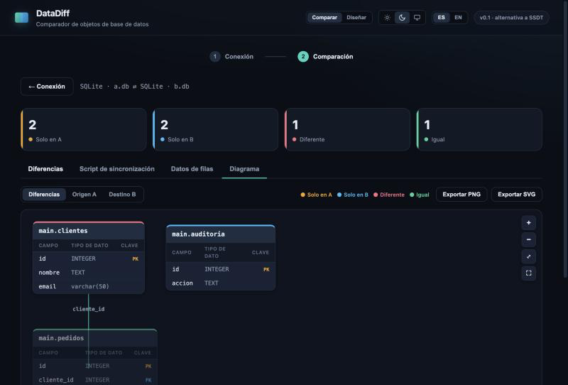
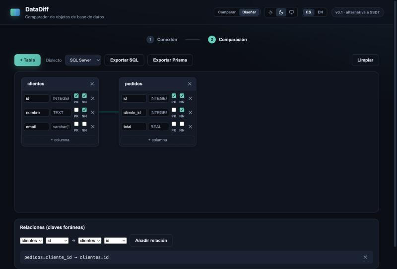

# Schemir

> Cross-platform **database schema & data** comparator — multi-engine and open source.
> A free alternative to **SSDT Schema Compare**, built with **Rust + Tauri**.

[](https://github.com/marlontaro/Schemir/actions/workflows/ci.yml)
[](https://github.com/marlontaro/Schemir/releases/latest)


**Schemir** connects to two databases (A = source, B = target), compares their **objects**
(structure) and their **data**, and shows you what is extra, missing or different between A
and B. It generates the **sync script** to make B match A, draws an interactive
**entity-relationship diagram**, and includes a **designer** to build models and export them
to SQL and Prisma.

The name is **Schema + Mirror** — read two schemas, make one mirror the other.

---

## 📥 Download

Grab the installer for your OS from the [**latest release**](https://github.com/marlontaro/Schemir/releases/latest):

| OS | Files |
|---|---|
| 🍎 **macOS** (Apple Silicon) | `.dmg` |
| 🪟 **Windows** | `.msi` · `.exe` |
| 🐧 **Linux** | `.AppImage` · `.deb` · `.rpm` |

> The macOS build is currently unsigned — right-click → **Open** the first time.

---

## 📸 Screenshots

**Object comparison** — summary by status and per-object detail:


**Difference diagram** — interactive (zoom, pan, drag, fullscreen):



**ER designer** — build a model and export it to SQL / Prisma:



---

## ✨ Features

**Compare**
- 🔌 **Four engines:** SQL Server, PostgreSQL, MySQL / MariaDB and SQLite.
- 🔁 **Dependent modules are refreshed** (SQL Server). SQL Server resolves view and
  routine references lazily and caches their metadata, so reshaping a table leaves every view
  and procedure built on it announcing the old columns. Schemir reads the real dependency
  graph from `sys.sql_expression_dependencies` and emits `EXECUTE sp_refreshsqlmodule` for
  everything that depends on a reshaped table, directly or through other modules, in
  dependency order — skipping whatever the script already re-creates.
- 🏷️ **Constraints the engine named itself are matched by shape, not by name.** SQL Server
  bautizes an unnamed `UNIQUE`, `CHECK` or `FOREIGN KEY` with a per-database suffix
  (`UQ__Product__F25D9D35E79EE34A`), so two databases built from the same script would
  otherwise show differences that do not exist. Names a person chose are still compared as
  names: renaming your own index *is* a change.
- 🗂️ **Connect first, then pick the database.**  reaches the *server*,
  not a database, and brings back the list of the ones your login can actually open
  (filtered by `HAS_DBACCESS` on SQL Server, `has_database_privilege` on PostgreSQL); the
  field turns into a real dropdown. Where the login cannot enumerate them, it falls back to a
  plain text box so you are never stuck.
- 🔌 **Connects to SQL Server the way SSMS does.** On Windows, Schemir goes through the
  Microsoft ODBC driver, which speaks **shared memory, named pipes *and* TCP** and resolves
  Windows authentication itself. Type the server name, leave the port alone, and it works
  against a local instance **even when TCP/IP is disabled** — which is how many local
  installs ship. No port to open, no server to reconfigure. Where no ODBC driver is
  installed, and on macOS and Linux, it falls back to a pure-Rust TCP driver; `Test
  connection` says which of the two it used.
- 🔐 **Windows authentication** on SQL Server, the way SSDT connects by default:
  Schemir enters as the Windows user of the current session, so there is no password to type
  and none to store.
- 🧱 **Every object:** tables and columns (type, nullability, *default*), views, procedures,
  functions, **primary & foreign keys, indexes, CHECK constraints and triggers**.
- 🎛️ **Comparison options** (SSDT-style): ignore case, whitespace, comments and column
  defaults; and choose **which object types** to compare.
- 🗂️ **Multi-schema:** reads and compares every schema (`dbo`, `public`, whatever you have).
  In MySQL / MariaDB the schema *is* the database, so that is what gets compared.
- 📊 **Row-data comparison** (SQLite): matches by primary key and reports rows only in A /
  only in B / different, with their DML (`INSERT` / `UPDATE` / `DELETE`).

**Synchronize**
- 📝 **Sync script** (`CREATE` / `ALTER` / `DROP`), dialect-aware, with **selective sync**:
  check/uncheck which objects go in. Copy or save as `.sql`.
- 🛡️ **Block on possible data loss** (on by default, as in SSDT): before dropping a column or
  a table, or changing a column's type, the script carries a guard that stops it if the
  affected table has rows. Each engine in its own way — `RAISERROR` in SQL Server,
  `RAISE EXCEPTION` in PostgreSQL, a violated CHECK in SQLite and a violated NOT NULL in
  MySQL / MariaDB.
- 🔢 **Auto-generated columns** are read and re-emitted per engine: SQL Server's
  `IDENTITY` (seed and increment included), PostgreSQL identity columns *and* `serial`,
  MySQL / MariaDB's `AUTO_INCREMENT`, SQLite's `AUTOINCREMENT`. Where the target dialect
  cannot express what the source has, the script says so in a comment instead of dropping it
  in silence.
- ⚡ **Apply to target** from the app, with confirmation and — where the engine allows it —
  inside a **transaction** (only the checked objects). See the table below.

**Visualize & design**
- 🗺️ **ER diagram** with a custom renderer (dagre): **Field · Type · Key** headers, 🔑 PK /
  🔗 FK marks, relationships, and a **color-coded difference diagram**. Interactive (zoom,
  pan, drag tables, fullscreen) and **exportable to PNG / SVG**.
- 🎨 **ER designer**, the ERwin way: **pick the data type** from the engine's own
  catalogue instead of typing it, and the designer knows whether it takes a length
  (`varchar(50)`), the two figures of precision and scale (`decimal(18,2)`) or nothing
  at all. Tables belong to a **schema** you can create and assign, you drag them around,
  and you **draw a relationship by dragging** from one column onto another table — a
  dialog then names the foreign key and sets its `ON DELETE` / `ON UPDATE`.
- 🔗 **Relationships migrate the key, the way ERwin does:** drag from the parent’s
  key onto the child table. If the child has no such column, it is created for you — same
  name, inherits the parent column’s type (they must match or the engine refuses the
  foreign key), `NOT NULL`, outside the primary key, so the relationship is
  non-identifying. The default name reads as a sentence: `fkUserroleHasUser`. Nothing is
  created until you accept the dialog.
- 🗝️ **A composite primary key migrates whole:** the relationship carries every
  column of the parent's key, not one of them, because they are one key seen from the
  child and splitting it would mean nothing. The dialog shows a row per column, and the
  foreign key comes out as `FOREIGN KEY (a, b) REFERENCES t (a, b)`. Drag from a column
  that is *not* part of the key and only that one migrates.
- 🔁 **Change the parent's key and the key follows:** the parent's primary key and
  the one that migrated to the child are the same key seen twice, so moving a column into
  or out of the primary key moves the foreign key with it — a new one migrates down with
  its type, one that leaves stops being foreign, and reordering the key reorders
  `FOREIGN KEY (a, b)`. A column that leaves the key is never deleted from the child: it
  keeps its data. Relationships you pointed at some other column on purpose are left
  alone, and so is a table that references itself, where no automatic answer would do.
- 🔀 **Logical and physical, one model seen twice.** Switch the view and the canvas
  reads `Pedido de venta · Fecha de emisión` instead of `dbo.pedido · fecha`. The physical
  name stays the model's identity — relations point at physical columns and the script is
  written with them — so a business name is a label and can never break anything. The
  logical view shows no engine types and no schema, because neither exists in a business
  model, and a column with no logical name falls back to its physical one.
- 🎨 **Colour your tables**, the way ERwin does, to group what belongs together. The
  model stores the *name* of the colour, not the pixel: a `#1b5e20` picked on a white
  canvas is black-on-black the moment you switch to the dark theme, so each theme tints
  its own surface with that hue instead. The tree shows the same dot as the card.
- 🧰 **A palette: pick the kind first, then drag.** Identifying, non-identifying or
  many-to-many, chosen before you draw, the way ERwin does it. Identifying puts the
  migrated key *inside* the child's primary key — solid line, rounded corners — and
  non-identifying leaves it out. The kind is never stored: it IS where the columns sit, so
  the label can't say one thing while the model says another. Many-to-many builds the
  bridge table with both keys. The palette fires once and hands the arrow back.
- 🗂️ **Design mode is a workspace, not a page.** It takes the whole window: an object
  tree on the left (tables, relations, schemas, each with its count), the canvas filling
  everything else, and a status bar that says what is selected — ERwin's Model Explorer,
  minus the 2005 chrome. Click in the tree to select, click a card and the tree follows;
  double-click either to open it. Compare mode stays the centred, scrolling page it was,
  because a report is read top to bottom.
- 📐 **Built for a real model: one column, one line.** An entity writes each column
  the way ERwin does — `Nombre: varchar(500) NOT NULL` — instead of a name on the left
  fighting a type on the right for the width. Fifteen columns fit in a small box and none
  of them is cut off. Relationship lines are **right-angled**, not diagonal: across fifteen
  tables a diagonal crosses everything in its way.
- ↕️ **Cards resize both ways.** Give a card a height and its column list scrolls
  inside it, with the primary key always on top: a thirty-column table fits in the box you
  give it instead of covering the diagram. Double-click the corner for its natural size.
- 🗃️ **The entity on the canvas is a view, not a form**, the way ERwin has it:
  primary key in the top compartment above a dividing line, `(FK)` marks, rounded corners
  on an entity that depends on another to identify itself. **Double-click** opens the
  table editor, where the columns have room. Relationship lines carry **crow’s foot**
  notation on the many end and go **dashed when the relationship is non-identifying** —
  all of it derived from the model, nothing to set by hand.
- 🔑 **Keys that fill themselves:** a counter (`IDENTITY(1,1)`, `AUTO_INCREMENT`,
  `GENERATED BY DEFAULT AS IDENTITY`, `AUTOINCREMENT`) or an engine-generated unique id
  (`NEWSEQUENTIALID()`, `gen_random_uuid()`). Each is offered only on the types that
  engine actually accepts, and a new table’s key starts as the engine’s own uuid type
  where there is one.
- 📌 **Minimum engine version**, worked out rather than assumed: every type carries the
  version it appeared in, you pick a target version, and the designer flags a type that
  is newer than it. The exported SQL states the version your model actually requires.
- 💾 **Save and open the model as XML** — shareable, diffable in git, and readable by
  hand; exports to **SQL** (SQL Server / PostgreSQL / MySQL / SQLite) and **Prisma**.
- 📄 **Difference report** in HTML (printable to PDF) with summary, detail and script.

**Comfort**
- 💾 **Recent connections** and **save / open a comparison** (`.ddcmp`) — passwords are never
  stored.
- 🌐 **Bilingual ES / EN** (auto-detects your system language) and 🌗 **light / dark / system**
  theme.
- 🔒 Comparison is enabled only when **both connections** test OK; databases are opened
  **read-only** (never modified unless you press *Apply*).

## 🔌 Supported engines

| Engine | Driver | Schema | Data | Apply in a transaction | Data-loss guard | Auto-generated columns |
|---|---|:--:|:--:|:--:|:--:|:--:|
| **SQL Server** | `tiberius` | ✅ | — | ✅ | ✅ | ✅ `IDENTITY(seed, step)` |
| **PostgreSQL** | `tokio-postgres` (TLS) | ✅ | — | ✅ | ✅ | ✅ identity + `serial` (PG 10+) |
| **MySQL / MariaDB** | `mysql_async` (TLS when offered) | ✅ | — | — | ✅ | ✅ `AUTO_INCREMENT` |
| **SQLite** | `rusqlite` (bundled) | ✅ | ✅ | ✅ | ✅ | ⚠️ `AUTOINCREMENT` on the PK only |

> **MySQL and MariaDB** speak the same protocol and expose the same `information_schema`,
> so a single reader covers both.
>
> **Windows authentication** is available for **SQL Server** when Schemir itself runs on
> Windows. Tick the box and the user and password fields grey out; the flag is remembered
> with the connection, since there is no secret in it. The other three engines use user and
> password.
>
> **Two ways in for SQL Server.** With an ODBC driver installed (Windows), Schemir uses it and
> lets it pick the transport exactly as SSMS would — that is why the port can be left at its
> default: writing a port forces TCP. Otherwise it uses `tiberius` over TCP, which needs
> nothing installed but does need the server listening. Reading the same 151-object schema
> took **3.1 s over ODBC** against **1.1 s over TCP**: ODBC asks for every value as text and
> fetches row by row, which is the price of not needing a port.
>
> **No transaction in MySQL / MariaDB:** the engine commits implicitly on every DDL
> statement, so there is nothing to roll back. The data-loss guard still works there — it
> stops the script *before* the destructive statements run — but a failure halfway through
> leaves the earlier statements applied. On the other three engines the whole script is
> applied inside a transaction, so a failure leaves the database untouched.
>
> **Auto-generated columns:** only SQL Server reports the seed and the step column by
> column, so on the other three they are read as `(1, 1)` — which is what an empty target
> table wants anyway. The *current* value of the sequence is never carried over (SSDT does
> not either): the target starts from the declared seed. SQLite is the odd one out because
> `AUTOINCREMENT` only exists as `INTEGER PRIMARY KEY AUTOINCREMENT`; anything else (a
> composite key, a non-integer column, adding the column with `ALTER`) gets a warning
> comment rather than a silent loss.
>
> **Data** comparison ships today for **SQLite** (covered by tests); the logic is
> engine-agnostic, so extending it to the other engines is just adding their row reader.

---

## 🚀 Getting started (development)

Requirements: **Rust** (recent, for Tauri 2) and **Node** (for the Tauri CLI).

```bash
rustup update stable
```
```bash
npm install
```
```bash
npm run tauri dev
```

> The first build takes a few minutes (it downloads and compiles Tauri and the drivers).
> You can also run the binary directly: `cargo run --manifest-path src-tauri/Cargo.toml`.

### Quick test with SQLite (no server)

Create two sample databases with intentional differences and compare them (**SQLite** engine):

```bash
sqlite3 ejemplos/a.db "CREATE TABLE clientes(id INTEGER PRIMARY KEY, nombre TEXT NOT NULL, email VARCHAR(50)); CREATE TABLE pedidos(id INTEGER PRIMARY KEY, cliente_id INTEGER REFERENCES clientes(id), total REAL); CREATE INDEX ix_pedidos_cliente ON pedidos(cliente_id); CREATE VIEW v_resumen AS SELECT cliente_id, COUNT(*) n FROM pedidos GROUP BY cliente_id;"
sqlite3 ejemplos/b.db "CREATE TABLE clientes(id INTEGER PRIMARY KEY, nombre TEXT NOT NULL, email VARCHAR(100), activo INTEGER); CREATE TABLE pedidos(id INTEGER PRIMARY KEY, cliente_id INTEGER REFERENCES clientes(id), total REAL); CREATE UNIQUE INDEX ux_clientes_email ON clientes(email); CREATE TABLE auditoria(id INTEGER PRIMARY KEY, accion TEXT);"
```

---

## 🏗️ Architecture

The key to supporting several engines without duplicating logic: each engine reads its own
system catalogs and translates them into a **common model**. The diff, the script, the
diagram and the data comparison all work on that model alone.

```
  Driver (tiberius / tokio-postgres / mysql_async / rusqlite)
        │  reads the system catalogs
        ▼
  Introspection  →  Schema (normalized model, in schemir-core)
        │
        ├─▶ Diff engine        →  Only in A · Only in B · Different · Equal
        ├─▶ Sync script        →  CREATE / ALTER / DROP (per object, per dialect)
        ├─▶ Data comparison    →  INSERT / UPDATE / DELETE (by primary key)
        └─▶ Diagram model      →  entities + relationships
        ▼
  UI (Tauri + HTML/CSS/JS, bilingual and themeable)
```

### Project layout

```
Schemir/
├── crates/core/              # schemir-core: pure Rust logic (with tests)
│   └── src/
│       ├── model.rs          #   Schema, Table, Column, Routine, ForeignKey, Index, Trigger…
│       ├── diff.rs           #   compare_schemas_opts() + CompareOptions
│       ├── script.rs         #   generate_sync_units_opts() / generate_sync_script_opts()
│       ├── data.rs           #   compare_table_data() → row DML
│       └── diagram.rs        #   to_diagram_model() / to_diff_diagram_opts()
├── src-tauri/                # Tauri app (Rust backend)
│   └── src/
│       ├── main.rs           #   commands: compare_databases, compare_data, apply_script,
│       │                     #             test_connection, save/read_text_file, save_binary_file
│       └── db/
│           ├── mod.rs        #   ConnectionConfig + per-engine dispatch
│           ├── sqlserver.rs  #   SQL Server introspection (tiberius)
│           ├── postgres.rs   #   PostgreSQL introspection (tokio-postgres)
│           ├── mysql.rs      #   MySQL / MariaDB introspection (mysql_async)
│           └── sqlite.rs     #   introspection + data reading (rusqlite)
├── src/                      # frontend (HTML/CSS/JS, no framework)
│   ├── index.html · styles.css · main.js
│   └── vendor/dagre.min.js   #   diagram layout
└── .github/workflows/        # CI (build + tests) and Release (installers)
```

### Tests

The core (model, diff, script, data, diagram) is tested without any database, and there are
integration tests that read real SQLite. **CI** runs them on every push.

```bash
cargo test                                      # core (schemir-core)
cargo test --manifest-path src-tauri/Cargo.toml # app + integration (SQLite)
```

---

## 🗺️ Roadmap & limitations

- **Data** comparison covers **SQLite** today (structure covers all four engines).
- **SQL Server and SQLite are verified end-to-end against real databases.** SQL Server was
  read against a 151-object schema in daily use (25 tables, 21 views, 22 procedures, 23
  functions, 31 foreign keys, 30 indexes): Schemir read both sides with Windows
  authentication in ~1.1 s and reported every one of 17 deliberately introduced differences,
  down to the column detail. **PostgreSQL and MySQL / MariaDB are still not verified
  end-to-end** — the code compiles and the dialect and parsing logic are unit-tested, but
  their catalog queries have never run against a real server.
- **How the ODBC path came to be,** because it is a useful story: the instance Schemir was
  verified against has **no ordinary TCP listener at all** — TCP/IP and named pipes are both
  disabled and only shared memory is on, which is how plenty of local installs ship. The one
  open port was 1434, the **DAC** (dedicated administrator connection), which SQL Server always
  opens locally and which accepts exactly *one* connection. Schemir's TCP driver found it and
  went in through it; since a comparison opens **one connection per side and holds both at
  once**, about half the runs died mid-read with `os error 10054`, and the server log named it
  (`Error 17810: the maximum number of '1' dedicated administrator connections already
  exists`). The fix was not to ask the user to open a port: it was to connect the way SSMS
  does. Over ODBC the same comparison now runs over shared memory, verified by asking the
  server itself (`sys.dm_exec_connections.net_transport` reports `Shared memory`, no TCP port),
  and both sides of the 151-object schema read in 3.1 s.
- **Measured against SSDT** on that same pair (`SqlPackage /Action:Script` and
  `/Action:DeployReport`, from a `.dacpac` of the source — SqlPackage refuses database against
  database, that lives only in the Visual Studio window). **The two tools now agree object for
  object**: the same 6 objects to drop, the same 3 objects to alter, and the same 7 to create.
  Three things are still worth knowing:
  - **Module refreshing is now covered, and Schemir casts a wider net than SSDT.** On the
    same pair, SSDT refreshed 18 modules and Schemir refreshes 37. Schemir's rule is the one
    it can state exactly: the transitive closure of the dependency graph over the reshaped
    tables (47 modules), minus the 10 the script already re-creates. SSDT prunes further —
    it skipped scalar functions and multi-statement table-valued functions, whose result
    shape is declared rather than inferred, and two procedures we cannot account for from a
    single sample. Rather than guess at a rule we only half understand, Schemir refreshes
    everything that could be stale: an unnecessary `sp_refreshsqlmodule` revalidates and
    moves on, whereas a missing one leaves a view lying about its own columns.
  - **The data-loss guard is more cautious than SSDT's:** it treats every type change as
    dangerous, widenings included. Going from `varchar(400)` to `varchar(800)` cannot lose
    anything and SSDT does not flag it, but Schemir stops the script.
  - A `UNIQUE` *constraint* is read as a unique *index*, so Schemir emits it as a separate
    `CREATE UNIQUE INDEX` where SSDT folds it into the `CREATE TABLE`. Same end state,
    different shape of script.
  Not a defect, just a different strategy: for a table whose columns change, **SSDT rebuilds
  the whole table** (temp table, `IDENTITY_INSERT`, copy, drop, rename) and therefore also
  drops and recreates every foreign key pointing at it, while Schemir emits in-place `ALTER`
  statements — four, against SSDT's ~90 lines. Schemir's script is far smaller; SSDT's
  survives changes that `ALTER` cannot express.
- **Large tables:** data comparison currently loads up to **100k rows** into memory. Comparing
  tables with **millions of rows** is planned via **streaming comparison by primary key + row
  hashing** (constant memory, minimal data transfer) — schema comparison is unaffected.
- PostgreSQL uses TLS when the server supports it and **trusts its certificate**; enforcing CA
  validation is a planned option.
- In SQLite, adding or dropping a foreign key requires rebuilding the table, so the script
  marks it with a comment instead of emitting the `ALTER` (the other engines do emit it).
- In MySQL / MariaDB, routines and triggers are emitted wrapped in `DELIMITER` (their bodies
  contain `;`), and `Apply to target` runs the script **statement by statement without a
  transaction**: MySQL commits implicitly on every DDL, so a failure halfway leaves the
  earlier statements applied.
- The **data-loss guard** has been checked against a real database on **SQLite** and
  **SQL Server** (the script does abort and nothing is applied); on PostgreSQL and
  MySQL / MariaDB it is only covered by unit tests on the generated SQL.
- **Auto-generated columns** are read and emitted on all four engines, and verified against
  a real database on **SQL Server** (the DDL *and* the catalog query, including a
  `IDENTITY(100,5)` column and adding an `IDENTITY` column to a populated table) and on
  **SQLite**; on PostgreSQL and MySQL / MariaDB only by unit tests on the generated SQL.
  What is still out of reach, and said in a comment in the script rather than lost quietly:
  SQL Server cannot add or remove `IDENTITY` with `ALTER` (the table has to be rebuilt);
  SQLite can only express `AUTOINCREMENT` on an `integer` column that is the whole primary
  key, and no `ALTER` of its own can add one; MySQL / MariaDB require the `AUTO_INCREMENT`
  column to be a key, and cannot set a seed or a step per column. **Reading identity columns
  on PostgreSQL needs version 10 or later** (`pg_attribute.attidentity`); a `serial` column
  is translated into a real identity column, so the target no longer needs the separate
  sequence that used to make the script fail.
- **Computed / generated columns are a different thing and are still not read:**
  `GENERATED ALWAYS AS (<expression>)` is read as a plain column of its result type.
- **User-defined types are not compared, and there is no dependency ordering.** A procedure
  or a column that uses a type of your own is emitted verbatim, so the script fails in the
  target because the type was never created. Units are emitted by fixed category (tables →
  columns → keys → indexes → constraints → views → routines → triggers), not sorted by what
  depends on what, so a view built on another view can also come out in the wrong order.
- **No type mapping between engines:** the column type is copied as the source engine
  reported it, so comparing *different* engines produces a script that reads fine and does
  not run (`nvarchar(50)` or `uniqueidentifier` against PostgreSQL, for instance).
  Same-engine comparison — the real use today — is unaffected.

On the radar: row data for SQL Server / PostgreSQL / MySQL, a type map between engines,
dependency ordering, computed columns, more objects (sequences, user-defined types),
and a signed macOS build.

---

## 🇪🇸 Español

**Schemir** es un comparador de **esquema y datos** de bases de datos, open source y
multiplataforma — una alternativa a SSDT Schema Compare hecha con **Rust + Tauri**. Compara
objetos (tablas, columnas, vistas, procedimientos, funciones, claves primarias/foráneas,
índices, restricciones CHECK y disparadores) en **SQL Server, PostgreSQL, MySQL / MariaDB y
SQLite**, con opciones de comparación estilo SSDT. Genera un **script de sincronización**
consciente del dialecto con **aplicación selectiva** y con **bloqueo ante posible pérdida de
datos** (el script se detiene si la tabla que va a perder una columna, un tipo o sus filas no
está vacía). Lee y vuelve a emitir las **columnas que se autogeneran** en los cuatro motores
(`IDENTITY`, `AUTO_INCREMENT`, `AUTOINCREMENT`, identidad y `serial`), y cuando el motor
destino no puede expresarlas lo dice en un comentario en vez de perderlas en silencio.
Compara **datos de filas** (SQLite) produciendo
`INSERT`/`UPDATE`/`DELETE`, dibuja un **diagrama ER interactivo** (exportable a PNG/SVG) e
incluye un **diseñador ER** que exporta a **SQL** y **Prisma**. La interfaz es bilingüe
(ES/EN, autodetecta el idioma del sistema) con tema claro/oscuro/sistema.

Descarga el instalador de tu sistema desde la [**última versión**](https://github.com/marlontaro/Schemir/releases/latest).

---

## 📄 License

[MIT](LICENSE) — © 2026 SOEN.
