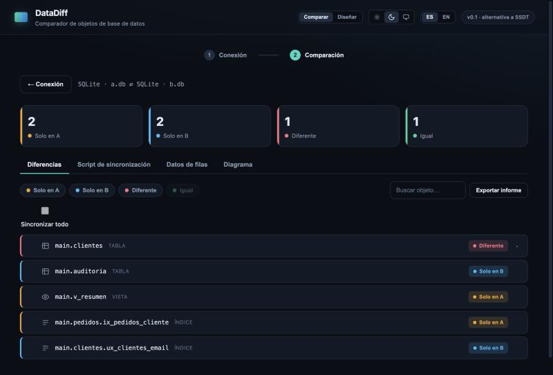

# Schemir

> Cross-platform **database schema & data** comparator — multi-engine and open source.
> A free alternative to **SSDT Schema Compare**, built with **Rust + Tauri**.

[](https://github.com/marlontaro/Schemir/actions/workflows/ci.yml)
[](https://github.com/marlontaro/Schemir/releases/latest)


**Schemir** connects to two databases (A = source, B = target), compares their **objects**
(structure) and their **data**, and shows you what is extra, missing or different between A
and B. It generates the **sync script** to make B match A, draws an interactive
**entity-relationship diagram**, and includes a **designer** to build models and export them
to SQL and Prisma.

The name is **Schema + Mirror** — read two schemas, make one mirror the other.

---

## 📥 Download

Grab the installer for your OS from the [**latest release**](https://github.com/marlontaro/Schemir/releases/latest):

| OS | Files |
|---|---|
| 🍎 **macOS** (Apple Silicon) | `.dmg` |
| 🪟 **Windows** | `.msi` · `.exe` |
| 🐧 **Linux** | `.AppImage` · `.deb` · `.rpm` |

> The macOS build is currently unsigned — right-click → **Open** the first time.

---

## 📸 Screenshots

**Object comparison** — summary by status and per-object detail:



**Difference diagram** — interactive (zoom, pan, drag, fullscreen):


**ER designer** — build a model and export it to SQL / Prisma:


---

## ✨ Features

**Compare**
- 🔌 **Four engines:** SQL Server, PostgreSQL, MySQL / MariaDB and SQLite.
- 🧱 **Every object:** tables and columns (type, nullability, *default*), views, procedures,
  functions, **primary & foreign keys, indexes, CHECK constraints and triggers**.
- 🎛️ **Comparison options** (SSDT-style): ignore case, whitespace, comments and column
  defaults; and choose **which object types** to compare.
- 🗂️ **Multi-schema:** reads and compares every schema (`dbo`, `public`, whatever you have).
  In MySQL / MariaDB the schema *is* the database, so that is what gets compared.
- 📊 **Row-data comparison** (SQLite): matches by primary key and reports rows only in A /
  only in B / different, with their DML (`INSERT` / `UPDATE` / `DELETE`).

**Synchronize**
- 📝 **Sync script** (`CREATE` / `ALTER` / `DROP`), dialect-aware, with **selective sync**:
  check/uncheck which objects go in. Copy or save as `.sql`.
- 🛡️ **Block on possible data loss** (on by default, as in SSDT): before dropping a column or
  a table, or changing a column's type, the script carries a guard that stops it if the
  affected table has rows. Each engine in its own way — `RAISERROR` in SQL Server,
  `RAISE EXCEPTION` in PostgreSQL, a violated CHECK in SQLite and a violated NOT NULL in
  MySQL / MariaDB.
- 🔢 **Auto-generated columns** are read and re-emitted per engine: SQL Server's
  `IDENTITY` (seed and increment included), PostgreSQL identity columns *and* `serial`,
  MySQL / MariaDB's `AUTO_INCREMENT`, SQLite's `AUTOINCREMENT`. Where the target dialect
  cannot express what the source has, the script says so in a comment instead of dropping it
  in silence.
- ⚡ **Apply to target** from the app, with confirmation and — where the engine allows it —
  inside a **transaction** (only the checked objects). See the table below.

**Visualize & design**
- 🗺️ **ER diagram** with a custom renderer (dagre): **Field · Type · Key** headers, 🔑 PK /
  🔗 FK marks, relationships, and a **color-coded difference diagram**. Interactive (zoom,
  pan, drag tables, fullscreen) and **exportable to PNG / SVG**.
- 🎨 **ER designer:** build a model from scratch (tables, columns with PK/NOT NULL and
  relationships) and export it to **SQL** (SQL Server / PostgreSQL / MySQL / SQLite) and
  **Prisma**.
- 📄 **Difference report** in HTML (printable to PDF) with summary, detail and script.

**Comfort**
- 💾 **Recent connections** and **save / open a comparison** (`.ddcmp`) — passwords are never
  stored.
- 🌐 **Bilingual ES / EN** (auto-detects your system language) and 🌗 **light / dark / system**
  theme.
- 🔒 Comparison is enabled only when **both connections** test OK; databases are opened
  **read-only** (never modified unless you press *Apply*).

## 🔌 Supported engines

| Engine | Driver | Schema | Data | Apply in a transaction | Data-loss guard | Auto-generated columns |
|---|---|:--:|:--:|:--:|:--:|:--:|
| **SQL Server** | `tiberius` | ✅ | — | ✅ | ✅ | ✅ `IDENTITY(seed, step)` |
| **PostgreSQL** | `tokio-postgres` (TLS) | ✅ | — | ✅ | ✅ | ✅ identity + `serial` (PG 10+) |
| **MySQL / MariaDB** | `mysql_async` (TLS when offered) | ✅ | — | — | ✅ | ✅ `AUTO_INCREMENT` |
| **SQLite** | `rusqlite` (bundled) | ✅ | ✅ | ✅ | ✅ | ⚠️ `AUTOINCREMENT` on the PK only |

> **MySQL and MariaDB** speak the same protocol and expose the same `information_schema`,
> so a single reader covers both.
>
> **No transaction in MySQL / MariaDB:** the engine commits implicitly on every DDL
> statement, so there is nothing to roll back. The data-loss guard still works there — it
> stops the script *before* the destructive statements run — but a failure halfway through
> leaves the earlier statements applied. On the other three engines the whole script is
> applied inside a transaction, so a failure leaves the database untouched.
>
> **Auto-generated columns:** only SQL Server reports the seed and the step column by
> column, so on the other three they are read as `(1, 1)` — which is what an empty target
> table wants anyway. The *current* value of the sequence is never carried over (SSDT does
> not either): the target starts from the declared seed. SQLite is the odd one out because
> `AUTOINCREMENT` only exists as `INTEGER PRIMARY KEY AUTOINCREMENT`; anything else (a
> composite key, a non-integer column, adding the column with `ALTER`) gets a warning
> comment rather than a silent loss.
>
> **Data** comparison ships today for **SQLite** (covered by tests); the logic is
> engine-agnostic, so extending it to the other engines is just adding their row reader.

---

## 🚀 Getting started (development)

Requirements: **Rust** (recent, for Tauri 2) and **Node** (for the Tauri CLI).

```bash
rustup update stable
```
```bash
npm install
```
```bash
npm run tauri dev
```

> The first build takes a few minutes (it downloads and compiles Tauri and the drivers).
> You can also run the binary directly: `cargo run --manifest-path src-tauri/Cargo.toml`.

### Quick test with SQLite (no server)

Create two sample databases with intentional differences and compare them (**SQLite** engine):

```bash
sqlite3 ejemplos/a.db "CREATE TABLE clientes(id INTEGER PRIMARY KEY, nombre TEXT NOT NULL, email VARCHAR(50)); CREATE TABLE pedidos(id INTEGER PRIMARY KEY, cliente_id INTEGER REFERENCES clientes(id), total REAL); CREATE INDEX ix_pedidos_cliente ON pedidos(cliente_id); CREATE VIEW v_resumen AS SELECT cliente_id, COUNT(*) n FROM pedidos GROUP BY cliente_id;"
sqlite3 ejemplos/b.db "CREATE TABLE clientes(id INTEGER PRIMARY KEY, nombre TEXT NOT NULL, email VARCHAR(100), activo INTEGER); CREATE TABLE pedidos(id INTEGER PRIMARY KEY, cliente_id INTEGER REFERENCES clientes(id), total REAL); CREATE UNIQUE INDEX ux_clientes_email ON clientes(email); CREATE TABLE auditoria(id INTEGER PRIMARY KEY, accion TEXT);"
```

---

## 🏗️ Architecture

The key to supporting several engines without duplicating logic: each engine reads its own
system catalogs and translates them into a **common model**. The diff, the script, the
diagram and the data comparison all work on that model alone.

```
  Driver (tiberius / tokio-postgres / mysql_async / rusqlite)
        │  reads the system catalogs
        ▼
  Introspection  →  Schema (normalized model, in schemir-core)
        │
        ├─▶ Diff engine        →  Only in A · Only in B · Different · Equal
        ├─▶ Sync script        →  CREATE / ALTER / DROP (per object, per dialect)
        ├─▶ Data comparison    →  INSERT / UPDATE / DELETE (by primary key)
        └─▶ Diagram model      →  entities + relationships
        ▼
  UI (Tauri + HTML/CSS/JS, bilingual and themeable)
```

### Project layout

```
Schemir/
├── crates/core/              # schemir-core: pure Rust logic (with tests)
│   └── src/
│       ├── model.rs          #   Schema, Table, Column, Routine, ForeignKey, Index, Trigger…
│       ├── diff.rs           #   compare_schemas_opts() + CompareOptions
│       ├── script.rs         #   generate_sync_units_opts() / generate_sync_script_opts()
│       ├── data.rs           #   compare_table_data() → row DML
│       └── diagram.rs        #   to_diagram_model() / to_diff_diagram_opts()
├── src-tauri/                # Tauri app (Rust backend)
│   └── src/
│       ├── main.rs           #   commands: compare_databases, compare_data, apply_script,
│       │                     #             test_connection, save/read_text_file, save_binary_file
│       └── db/
│           ├── mod.rs        #   ConnectionConfig + per-engine dispatch
│           ├── sqlserver.rs  #   SQL Server introspection (tiberius)
│           ├── postgres.rs   #   PostgreSQL introspection (tokio-postgres)
│           ├── mysql.rs      #   MySQL / MariaDB introspection (mysql_async)
│           └── sqlite.rs     #   introspection + data reading (rusqlite)
├── src/                      # frontend (HTML/CSS/JS, no framework)
│   ├── index.html · styles.css · main.js
│   └── vendor/dagre.min.js   #   diagram layout
└── .github/workflows/        # CI (build + tests) and Release (installers)
```

### Tests

The core (model, diff, script, data, diagram) is tested without any database, and there are
integration tests that read real SQLite. **CI** runs them on every push.

```bash
cargo test                                      # core (schemir-core)
cargo test --manifest-path src-tauri/Cargo.toml # app + integration (SQLite)
```

---

## 🗺️ Roadmap & limitations

- **Data** comparison covers **SQLite** today (structure covers all four engines).
- **SQL Server, PostgreSQL and MySQL / MariaDB** against real servers are not yet verified
  end-to-end: the code compiles and its dialect and parsing logic are unit-tested, but the
  only engine exercised against a real database is SQLite. The catalog queries may need
  tweaks against a real server.
- **Large tables:** data comparison currently loads up to **100k rows** into memory. Comparing
  tables with **millions of rows** is planned via **streaming comparison by primary key + row
  hashing** (constant memory, minimal data transfer) — schema comparison is unaffected.
- PostgreSQL uses TLS when the server supports it and **trusts its certificate**; enforcing CA
  validation is a planned option.
- In SQLite, adding or dropping a foreign key requires rebuilding the table, so the script
  marks it with a comment instead of emitting the `ALTER` (the other engines do emit it).
- In MySQL / MariaDB, routines and triggers are emitted wrapped in `DELIMITER` (their bodies
  contain `;`), and `Apply to target` runs the script **statement by statement without a
  transaction**: MySQL commits implicitly on every DDL, so a failure halfway leaves the
  earlier statements applied.
- The **data-loss guard** has been checked against a real database on **SQLite** and
  **SQL Server** (the script does abort and nothing is applied); on PostgreSQL and
  MySQL / MariaDB it is only covered by unit tests on the generated SQL.
- **Auto-generated columns** are read and emitted on all four engines, and verified against
  a real database on **SQL Server** (the DDL *and* the catalog query, including a
  `IDENTITY(100,5)` column and adding an `IDENTITY` column to a populated table) and on
  **SQLite**; on PostgreSQL and MySQL / MariaDB only by unit tests on the generated SQL.
  What is still out of reach, and said in a comment in the script rather than lost quietly:
  SQL Server cannot add or remove `IDENTITY` with `ALTER` (the table has to be rebuilt);
  SQLite can only express `AUTOINCREMENT` on an `integer` column that is the whole primary
  key, and no `ALTER` of its own can add one; MySQL / MariaDB require the `AUTO_INCREMENT`
  column to be a key, and cannot set a seed or a step per column. **Reading identity columns
  on PostgreSQL needs version 10 or later** (`pg_attribute.attidentity`); a `serial` column
  is translated into a real identity column, so the target no longer needs the separate
  sequence that used to make the script fail.
- **Computed / generated columns are a different thing and are still not read:**
  `GENERATED ALWAYS AS (<expression>)` is read as a plain column of its result type.
- **User-defined types are not compared, and there is no dependency ordering.** A procedure
  or a column that uses a type of your own is emitted verbatim, so the script fails in the
  target because the type was never created. Units are emitted by fixed category (tables →
  columns → keys → indexes → constraints → views → routines → triggers), not sorted by what
  depends on what, so a view built on another view can also come out in the wrong order.
- **No type mapping between engines:** the column type is copied as the source engine
  reported it, so comparing *different* engines produces a script that reads fine and does
  not run (`nvarchar(50)` or `uniqueidentifier` against PostgreSQL, for instance).
  Same-engine comparison — the real use today — is unaffected.

On the radar: row data for SQL Server / PostgreSQL / MySQL, a type map between engines,
dependency ordering, computed columns, more objects (sequences, user-defined types),
and a signed macOS build.

---

## 🇪🇸 Español

**Schemir** es un comparador de **esquema y datos** de bases de datos, open source y
multiplataforma — una alternativa a SSDT Schema Compare hecha con **Rust + Tauri**. Compara
objetos (tablas, columnas, vistas, procedimientos, funciones, claves primarias/foráneas,
índices, restricciones CHECK y disparadores) en **SQL Server, PostgreSQL, MySQL / MariaDB y
SQLite**, con opciones de comparación estilo SSDT. Genera un **script de sincronización**
consciente del dialecto con **aplicación selectiva** y con **bloqueo ante posible pérdida de
datos** (el script se detiene si la tabla que va a perder una columna, un tipo o sus filas no
está vacía). Lee y vuelve a emitir las **columnas que se autogeneran** en los cuatro motores
(`IDENTITY`, `AUTO_INCREMENT`, `AUTOINCREMENT`, identidad y `serial`), y cuando el motor
destino no puede expresarlas lo dice en un comentario en vez de perderlas en silencio.
Compara **datos de filas** (SQLite) produciendo
`INSERT`/`UPDATE`/`DELETE`, dibuja un **diagrama ER interactivo** (exportable a PNG/SVG) e
incluye un **diseñador ER** que exporta a **SQL** y **Prisma**. La interfaz es bilingüe
(ES/EN, autodetecta el idioma del sistema) con tema claro/oscuro/sistema.

Descarga el instalador de tu sistema desde la [**última versión**](https://github.com/marlontaro/Schemir/releases/latest).

---

## 📄 License

[MIT](LICENSE) — © 2026 SOEN.
