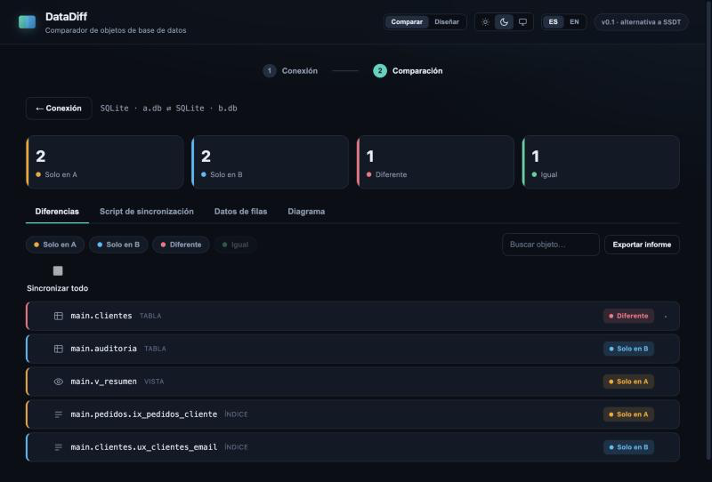
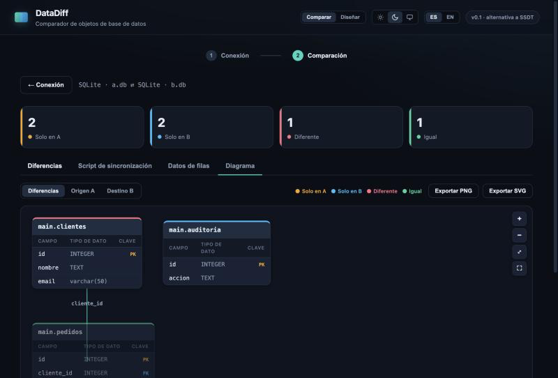
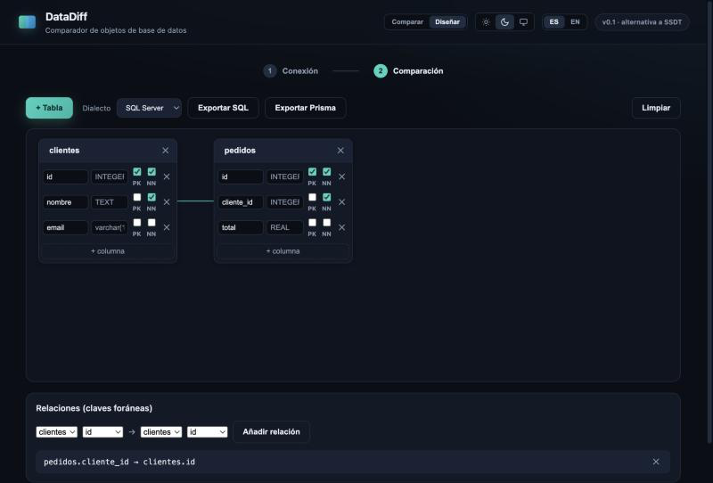

# DataDiff

> Comparador de **esquema y datos** de bases de datos — multiplataforma y multi-motor.
> Una alternativa open source a **SSDT Schema Compare**, hecha con **Rust + Tauri**.

[](https://github.com/marlontaro/DataDiff/actions/workflows/ci.yml)


DataDiff conecta a dos bases de datos (A = origen, B = destino), compara sus **objetos**
(estructura) y sus **datos**, y te muestra qué sobra, qué falta y qué difiere entre A y B.
Genera el **script de sincronización** para dejar B igual que A, dibuja un **diagrama
entidad-relación** interactivo e incluye un **diseñador** para crear modelos y exportarlos
a SQL y Prisma.

---

## 📸 Capturas

**Comparación de objetos** — resumen por estado y detalle por objeto:



**Diagrama de diferencias** — interactivo (zoom, desplazamiento, arrastrar, pantalla completa):



**Diseñador ER** — crea un modelo y expórtalo a SQL / Prisma:



---

## ✨ Características

**Comparar**
- 🔌 **Tres motores:** SQL Server, PostgreSQL y SQLite.
- 🧱 **Todos los objetos:** tablas y columnas (tipo, nulabilidad, *default*), vistas,
  procedimientos, funciones, **claves primarias y foráneas, índices, restricciones CHECK
  y disparadores (triggers)**.
- 🎛️ **Opciones de comparación** (estilo SSDT): ignorar mayúsculas/minúsculas, espacios,
  comentarios y el valor por defecto de columnas; y elegir **qué tipos de objeto** comparar.
- 🗂️ **Multiesquema:** lee y compara todos los esquemas (`dbo`, `public`, los que tengas).
- 📊 **Comparar datos de filas** (SQLite): empareja por clave primaria y reporta filas solo
  en A / solo en B / distintas, con su DML (`INSERT` / `UPDATE` / `DELETE`).

**Sincronizar**
- 📝 **Script de sincronización** (`CREATE` / `ALTER` / `DROP`) consciente del dialecto,
  con **sincronización selectiva**: marca/desmarca qué objetos entran. Copiar y guardar `.sql`.
- ⚡ **Aplicar al destino** desde la app, con confirmación y en una **transacción** (solo lo marcado).

**Visualizar y diseñar**
- 🗺️ **Diagrama ER** con renderizador propio (dagre): encabezados **Campo · Tipo · Clave**,
  marcas 🔑 PK / 🔗 FK, relaciones, y un **diagrama de diferencias a color**. Interactivo
  (zoom, desplazamiento, arrastrar tablas, pantalla completa) y **exportable a PNG / SVG**.
- 🎨 **Diseñador ER:** crea un modelo desde cero (tablas, columnas con PK/NOT NULL y
  relaciones) y expórtalo a **SQL** (SQL Server / PostgreSQL / SQLite) y a **Prisma**.
- 📄 **Informe de diferencias** en HTML (imprimible a PDF) con resumen, detalle y script.

**Comodidad**
- 💾 **Conexiones recientes** y **guardar / abrir una comparación** (`.ddcmp`) — nunca se
  guardan contraseñas.
- 🌐 **Bilingüe ES / EN** y 🌗 **tema claro / oscuro / sistema**.
- 🔒 Habilita la comparación solo cuando **ambas conexiones** están probadas; apertura en
  **solo lectura** (nunca modifica tus bases salvo que pulses *Aplicar*).

## 🔌 Motores soportados

| Motor | Driver | Esquema | Datos |
|---|---|:--:|:--:|
| **SQL Server** | `tiberius` | ✅ | — |
| **PostgreSQL** | `tokio-postgres` (TLS) | ✅ | — |
| **SQLite** | `rusqlite` (bundled) | ✅ | ✅ |

> La comparación de **datos** está disponible hoy para **SQLite** (verificada con pruebas);
> la lógica es agnóstica al motor, así que extenderla a SQL Server / PostgreSQL es solo
> añadir su lectura de filas.

---

## 🚀 Puesta en marcha (desarrollo)

Requisitos: **Rust** (reciente, para Tauri 2) y **Node** (para la CLI de Tauri).

```bash
rustup update stable
```
```bash
npm install
```
```bash
npm run tauri dev
```

> La primera compilación tarda varios minutos (baja y compila Tauri y los drivers).
> También puedes correr el binario directo: `cargo run --manifest-path src-tauri/Cargo.toml`.

### Probar rápido con SQLite (sin servidor)

Crea dos bases de ejemplo con diferencias a propósito y compáralas (motor **SQLite**):

```bash
sqlite3 ejemplos/a.db "CREATE TABLE clientes(id INTEGER PRIMARY KEY, nombre TEXT NOT NULL, email VARCHAR(50)); CREATE TABLE pedidos(id INTEGER PRIMARY KEY, cliente_id INTEGER REFERENCES clientes(id), total REAL); CREATE INDEX ix_pedidos_cliente ON pedidos(cliente_id); CREATE VIEW v_resumen AS SELECT cliente_id, COUNT(*) n FROM pedidos GROUP BY cliente_id;"
sqlite3 ejemplos/b.db "CREATE TABLE clientes(id INTEGER PRIMARY KEY, nombre TEXT NOT NULL, email VARCHAR(100), activo INTEGER); CREATE TABLE pedidos(id INTEGER PRIMARY KEY, cliente_id INTEGER REFERENCES clientes(id), total REAL); CREATE UNIQUE INDEX ux_clientes_email ON clientes(email); CREATE TABLE auditoria(id INTEGER PRIMARY KEY, accion TEXT);"
```

---

## 🏗️ Arquitectura

La clave para soportar varios motores sin duplicar lógica: cada motor lee sus catálogos
del sistema y los traduce a un **modelo común**. El diff, el script, el diagrama y la
comparación de datos trabajan solo sobre ese modelo.

```
  Driver (tiberius / tokio-postgres / rusqlite)
        │  lee los catálogos del sistema
        ▼
  Introspección  →  Schema (modelo normalizado, en datadiff-core)
        │
        ├─▶ Motor de diff      →  Solo en A · Solo en B · Diferente · Igual
        ├─▶ Script de sync     →  CREATE / ALTER / DROP (por objeto, por dialecto)
        ├─▶ Comparación de datos →  INSERT / UPDATE / DELETE (por clave primaria)
        └─▶ Modelo de diagrama →  entidades + relaciones
        ▼
  Interfaz (Tauri + HTML/CSS/JS, bilingüe y con temas)
```

### Estructura del proyecto

```
DataDiff/
├── crates/core/              # datadiff-core: lógica pura en Rust (con tests)
│   └── src/
│       ├── model.rs          #   Schema, Table, Column, Routine, ForeignKey, Index, Trigger…
│       ├── diff.rs           #   compare_schemas_opts() + CompareOptions
│       ├── script.rs         #   generate_sync_units_opts() / generate_sync_script_opts()
│       ├── data.rs           #   compare_table_data() → DML de filas
│       └── diagram.rs        #   to_diagram_model() / to_diff_diagram_opts()
├── src-tauri/                # app Tauri (backend Rust)
│   └── src/
│       ├── main.rs           #   comandos: compare_databases, compare_data, apply_script,
│       │                     #             test_connection, save/read_text_file, save_binary_file
│       └── db/
│           ├── mod.rs        #   ConnectionConfig + despacho por motor
│           ├── sqlserver.rs  #   introspección SQL Server (tiberius)
│           ├── postgres.rs   #   introspección PostgreSQL (tokio-postgres)
│           └── sqlite.rs     #   introspección + lectura de datos (rusqlite)
├── src/                      # frontend (HTML/CSS/JS, sin framework)
│   ├── index.html · styles.css · main.js
│   └── vendor/dagre.min.js   #   layout del diagrama
└── .github/workflows/ci.yml  # CI: compila y corre las pruebas en cada push
```

### Tests

El núcleo (modelo, diff, script, datos, diagrama) se prueba sin necesidad de ninguna base,
y hay pruebas de integración que leen SQLite de verdad. **CI** los corre en cada push.

```bash
cargo test                                      # núcleo (datadiff-core)
cargo test --manifest-path src-tauri/Cargo.toml # app + integración (SQLite)
```

---

## 🗺️ Limitaciones y futuro

- La **comparación de datos** cubre hoy **SQLite** (la de estructura, los tres motores).
- **SQL Server y PostgreSQL** contra servidores reales están sin verificar end-to-end: el
  código compila y se prueba con SQLite; las consultas a los catálogos podrían necesitar
  algún ajuste al conectar a una base real.
- PostgreSQL usa TLS cuando el servidor lo soporta y **confía en su certificado**; exigir la
  validación de la CA sería una opción a añadir.
- En SQLite, agregar o quitar una clave foránea requiere recrear la tabla, así que el script
  lo marca con un comentario en lugar de generar el `ALTER` (SQL Server y Postgres sí lo generan).

En el radar: datos de filas en SQL Server / PostgreSQL, más objetos (secuencias, tipos de
usuario), e instaladores para Windows (`.msi`) y Linux (`.AppImage`).

---

## 🇬🇧 English

DataDiff is an open-source, cross-platform **database schema & data comparator** — an
alternative to SSDT Schema Compare, built with **Rust + Tauri**. It compares objects
(tables, columns, views, procedures, functions, primary/foreign keys, indexes, CHECK
constraints and triggers) across **SQL Server, PostgreSQL and SQLite**, with SSDT-style
comparison options. It generates a dialect-aware **sync script** with **selective apply**,
compares **row data** (SQLite) producing `INSERT`/`UPDATE`/`DELETE`, draws an **interactive
ER diagram** (exportable to PNG/SVG), and ships an **ER designer** that exports to **SQL**
and **Prisma**. The UI is bilingual (ES/EN) with light/dark/system themes.

---

## 📄 Licencia

[MIT](LICENSE) — © 2026 SOEN.
